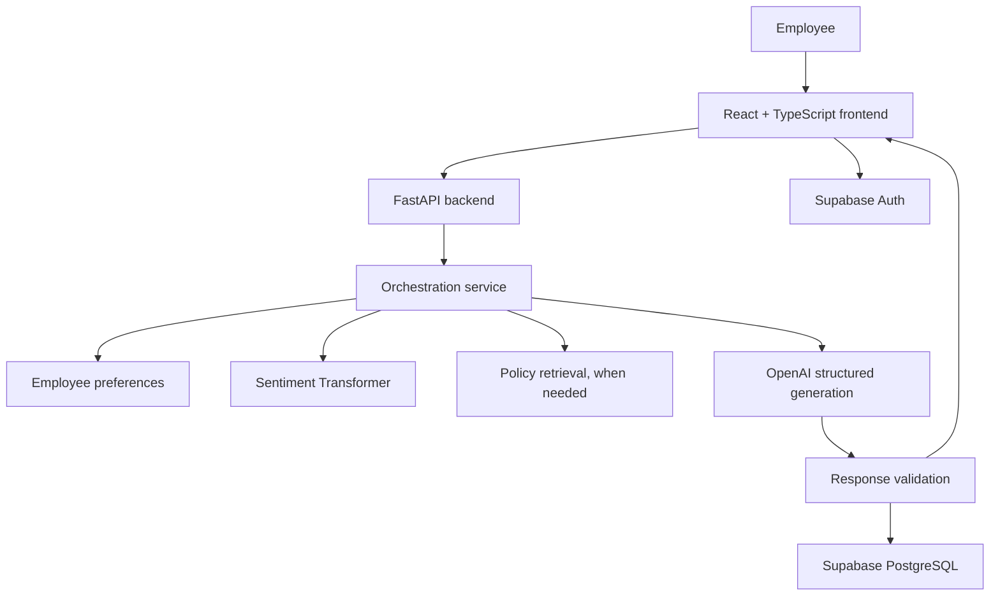

# NeuroLens

**Making workplace communication easier to understand, one conversation at a time.**

NeuroLens is a private, AI-powered workplace assistant that helps employees understand unclear messages, find answers in
company policies, and turn conversations into practical next steps.

It's designed with neurodivergent employees in mind, but anyone who benefits from clearer, more direct communication can
use it.

The idea is simple: **instead of expecting everyone to adapt to the same communication style, NeuroLens adapts to the
person using it.**

> **Project note:** NeuroLens is an MSc software project currently in early development. It uses **DuoSoft**, a
> fictional company, as its workplace setting. All employees, policies, and conversations used during development are
> synthetic.

---

## What does NeuroLens do?

NeuroLens focuses on three things: helping employees **understand** communication, **find** reliable information, and *
*take** the next step.

### 1. Understand — Make sense of workplace messages

Not every workplace message is straightforward. Sometimes a request is indirect, a deadline is implied, or it's
difficult to tell whether someone is asking for something or simply making a suggestion.

NeuroLens helps employees make sense of these messages without assuming what the sender actually meant or felt.

It can:

- Rewrite unclear messages in simpler, more direct language.
- Highlight ambiguous wording or missing information.
- Identify possible requests and expectations.
- Suggest replies that employees can review and edit.
- Explain when there isn't enough information to reach a conclusion.

For example, imagine receiving this message from a colleague:

> "It would be great if we could get this sorted sometime soon."

NeuroLens might explain:

> "This sounds like a request to complete something, but there isn't a clear deadline. You may want to ask when it's
> needed."

The goal isn't to tell employees how to interpret people. It's to help them understand what is being communicated and
decide how they want to respond.

### 2. Know — Find answers in company policies

Company policies aren't always easy to navigate. Information can be spread across several documents, and the wording is
often more complicated than necessary.

NeuroLens lets employees ask questions in everyday language and receive answers based on their organisation's policies.

For example:

> "Can I work from home three days a week?"

Rather than guessing, NeuroLens retrieves the relevant DuoSoft policy, explains what it says in plain language, and
shows the source where possible.

If the policy doesn't answer the question, NeuroLens says so instead of making something up.

### 3. Act — Turn conversations into manageable steps

Understanding a request is one thing. Knowing where to start is another.

NeuroLens helps employees turn conversations and instructions into practical next steps.

It can:

- Identify tasks and deadlines mentioned in messages.
- Break larger tasks into smaller, manageable steps.
- Suggest the smallest useful action to take next.
- Prepare draft leave requests for the employee to review.

The employee always stays in control. NeuroLens can suggest and prepare actions, but it won't send messages, submit
requests, or make changes on someone's behalf without explicit confirmation.

---

## Why we're building NeuroLens

Workplace communication often depends on things that aren't directly stated.

A colleague might expect someone to recognise an indirect request. A manager might assume a deadline is obvious. An
employee might spend extra time trying to understand the tone of a short message.

For some neurodivergent employees, navigating these expectations can take significant effort and create unnecessary
stress.

We want NeuroLens to reduce that burden.

Rather than trying to change how people communicate, we're building a tool that helps employees understand information
in a way that works for them.

**The goal is clarity, not interpretation on someone's behalf.**

NeuroLens doesn't claim to know what another person is thinking or feeling. It helps employees identify what is clear,
what is uncertain, and what they might want to ask next.

---

## What makes NeuroLens different?

NeuroLens uses existing AI technologies, but its value comes from how those technologies work together to support the
individual employee.

### Personalised communication

Employees choose how they want information presented. They can prefer shorter explanations, direct language,
step-by-step instructions, or explicit explanations of ambiguity.

These preferences are saved so employees don't have to repeat them every time they start a conversation.

### Answers grounded in company policies

When an employee asks about a company policy, NeuroLens retrieves relevant documentation before generating an answer.

Policy answers are supported by retrieved text, with source references where available. If there isn't enough evidence
to answer confidently, NeuroLens makes that clear.

### Hybrid natural language processing

NeuroLens combines two AI components that serve different purposes.

A dedicated pretrained sentiment Transformer independently classifies the wording of a message as **Positive, Neutral,
or Negative**.

A generative language model uses the conversation context, employee preferences, and relevant policy information to
produce a helpful response.

The sentiment classification describes the language used in the message. It does not determine the sender's actual
emotions or intentions.

### Structured and validated responses

Rather than relying on unrestricted AI-generated text, NeuroLens uses a defined response schema.

The backend validates the model's output before returning it to the employee, helping ensure that responses follow a
consistent structure.

### Private by design

Each employee has their own conversation history and communication preferences.

Authentication and PostgreSQL Row Level Security are used to isolate employee data. Managers and HR are not given access
to employee conversations through NeuroLens.

### Employees remain in control

NeuroLens is an assistant, not an autonomous agent.

It can recommend actions and prepare drafts, but an AI-generated response can never authorise an external action on its
own.

---

## How NeuroLens works

NeuroLens brings together employee preferences, sentiment analysis, policy retrieval, and structured AI generation in a
single conversation flow.

When an employee sends a message, the backend loads their communication preferences and a limited amount of relevant
conversation history.

The sentiment model analyses the wording of the message. If the employee asks about company policy, NeuroLens retrieves
the relevant policy information.

The generative model then uses the available context to prepare a structured response. Before the response reaches the
employee, the backend validates it against the expected schema.

The conversation is stored under the employee's account so they can continue where they left off.

### Why we're using OpenAI

For the initial prototype, we're using the OpenAI API for structured response generation.

However, NeuroLens isn't intended to depend permanently on a single AI provider.

The generative model sits behind a dedicated backend service, and its output follows a schema defined by the application
rather than by OpenAI.

This design makes it possible for a future organisation to replace OpenAI with a different model, including one hosted
internally, without redesigning the frontend or the rest of the processing pipeline.

Such a change would still require integration work, compatibility testing, and evaluation.

---

## Technology

We've chosen a relatively straightforward technology stack so we can focus on the functionality, privacy, and evaluation
of NeuroLens.

| Area                | Technologies                                  |
|---------------------|-----------------------------------------------|
| Frontend            | React, TypeScript, Tailwind CSS, Rspack, Yarn |
| Backend             | Python, FastAPI, Pydantic                     |
| Development tooling | uv, Ruff, pytest                              |
| Authentication      | Supabase Auth                                 |
| Database            | Supabase PostgreSQL with Row Level Security   |
| AI / NLP            | Pretrained sentiment Transformer, OpenAI API  |

The frontend handles the chat interface and employee preferences. The FastAPI backend manages application logic, AI
orchestration, response validation, and data access.

Supabase provides authentication and PostgreSQL storage, with Row Level Security enforcing employee-level data
isolation.

## For developers

NeuroLens is being developed as a two-person project, with a shared Git workflow and consistent coding conventions.

If you're joining the project or want to run it locally, everything you need is in [DEVELOP.md](DEVELOP.md).

The development guide covers:

- Setting up and running the frontend and backend.
- Installing dependencies and configuring environment variables.
- Connecting to Supabase.
- Project structure and coding conventions.
- Running tests, formatting, and linting.
- Creating branches, making commits, and opening pull requests.

We keep development instructions in one place so they're easier to maintain as the project evolves.

---

## Privacy and responsible AI

Privacy is an important part of NeuroLens, especially because employees may use it to discuss workplace conversations
they find confusing or difficult.

We want employees to be able to use the assistant without worrying that their conversations are being made available to
managers or HR.

Our design follows a few key principles:

- **Employee privacy:** conversations and communication preferences belong to the individual employee.
- **Data isolation:** Row Level Security is used to prevent employees from accessing each other's records.
- **Employee choice:** people decide how NeuroLens responds and whether to act on its suggestions.
- **Transparency:** sentiment labels describe the wording of a message, not someone's true emotional state.
- **Policy accuracy:** policy answers must be supported by retrieved documentation rather than guesses.
- **Human confirmation:** external actions require the employee's explicit approval.

### What NeuroLens isn't

NeuroLens is not intended to be:

- A replacement for Slack, Microsoft Teams, or other workplace messaging platforms.
- An employee monitoring or productivity scoring system.
- A manager or HR dashboard for viewing private conversations.
- A diagnostic, therapeutic, or clinical tool.
- An autonomous agent that makes decisions or takes actions without approval.
- A system that claims to detect someone's true emotions or intentions.

The prototype is designed with GDPR principles such as data minimisation and purpose limitation in mind. However, it
does not claim formal GDPR compliance.

---

## Roadmap

We're developing NeuroLens in stages, starting with a private, personalised chatbot and gradually introducing policy
assistance and task support.

### Build the foundation

Implement authentication, isolated employee data, saved communication preferences, and the first multi-turn conversation
flow using hybrid NLP and structured generation.

### Know — Make company policies accessible

Introduce policy retrieval so employees can ask questions about DuoSoft policies and receive answers supported by the
relevant documents.

The system should also recognise when a policy doesn't provide enough information to answer a question.

### Act — Help employees move forward

Add task and deadline extraction, manageable task breakdowns, and draft leave requests that employees can review before
taking action.

### Evaluation — Measure how well NeuroLens works

Evaluate NeuroLens using synthetic workplace scenarios, focusing on:

- Clarity and usefulness of responses.
- Handling of ambiguous communication.
- Adherence to employee preferences.
- Accuracy and grounding of policy answers.
- Ability to recognise unsupported questions and abstain.
- Consistency of structured outputs.

### Future — Explore optional integrations

Explore additional features such as calendar actions, while maintaining employee privacy and requiring explicit
confirmation before any external action. In the future, a company using NeuroLens can train their own LLM on their
actual data to replace Open AI's API.

---

## About the project

NeuroLens is being developed by a two-person team as part of an MSc software project.

We're using DuoSoft, a fictional organisation, to explore how AI can make workplace communication clearer and more
accessible without compromising employee privacy or autonomy.

The project is still in early development, and the documentation will evolve as we implement and evaluate new features.

Our aim isn't to build another general-purpose chatbot. It's to explore how a more focused, personalised assistant can
make everyday workplace communication a little easier to navigate.